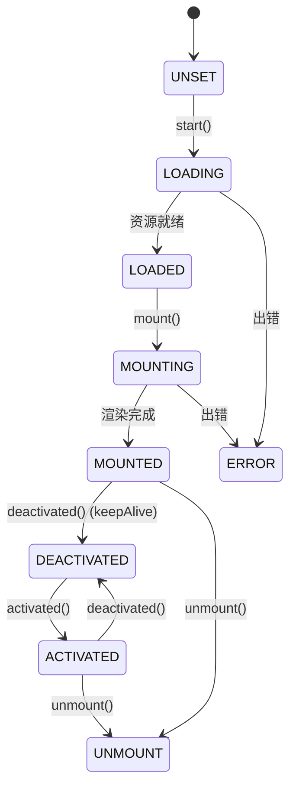

# 核心概念

理解以下三组概念，就能掌握 BK-WeWeb 的整体心智模型。

## 一、两种运行模式（WewebMode）

框架内部用枚举 `WewebMode` 区分运行模式：

```ts
enum WewebMode {
  APP = 'app',       // 微应用
  CONFIG = 'config', // 配置模式（内部使用）
  INSTANCE = 'js',   // 微模块
}
```

| 模式 | `mode` 值 | 入口类型 | 渲染方式 | 适用场景 |
| --- | --- | --- | --- | --- |
| **微应用** | `app`（默认） | HTML | 解析 HTML，提取并执行其中的 script / style，把内容渲染进容器 | 独立部署的完整应用、整页接入 |
| **微模块** | `js` | JS | 执行 JS 模块，调用其导出对象的 `render(container, data)` | 远程组件、插件、可复用的 UI 片段 |

> `config` 为内部模式，业务一般只关心 `app` 与 `js`。当 `<bk-weweb>` 不显式指定 `mode` 时，默认按微应用（`app`）处理；微模块必须显式 `mode="js"`。

加载入口会根据 `mode` 自动分流：`load()` 判断到 `mode === 'js'` 走 `loadInstance`，否则走 `loadApp`。

## 二、两种使用方式

同一套能力有两种调用方式，可混用：

### Web Component 标签

声明式，把 `<bk-weweb>` 写进模板即可，连接到 DOM 时自动加载挂载，移出 DOM 时自动卸载。适合"放在哪渲染在哪"的简单场景。

```html
<bk-weweb id="app1" url="http://localhost:8001/" scopeJs scopeCss></bk-weweb>
```

### Hooks API

命令式，通过 `loadApp` / `loadInstance` / `mount` / `unmount` / `activated` / `deactivated` 精确控制每个生命周期时机。适合需要预加载、按路由懒挂载、KeepAlive 等复杂场景。

```ts
import { loadApp, mount } from '@blueking/bk-weweb';
await loadApp({ url: 'http://localhost:8001/', id: 'app1' });
mount('app1', container);
```

> 实际上 Web Component 内部也是调用这些生命周期方法，二者共享同一份应用缓存（以 `id` / `url` 为键）。

## 三、主应用与子应用

- **主应用（Host）**：引入 `@blueking/bk-weweb`、放置容器、负责加载子应用的应用。
- **子应用（Child）**：被加载的远程应用或模块。子应用运行在沙箱中，可通过全局变量感知环境。

数据流向：

- 主应用 → 子应用：通过 `data` 属性 / 参数传入，子应用经 `window.__BK_WEWEB_DATA__` 读取。
- 子应用 → 主应用：微模块可在导出对象上提供方法（如 `getState`），主应用通过 `mount` 回调拿到导出实例后调用。

```ts
mount('chart', container, (instance, exportInstance) => {
  // exportInstance 即微模块导出的对象
  exportInstance?.update?.({ value: 100 });
});
```

## 应用状态机

每个应用实例维护一个状态（`AppState`），生命周期方法会驱动状态流转：



- `keepAlive` 为 `true` 时，`deactivated` 把状态置为 `DEACTIVATED` 并保留 DOM；再次 `activated` 可恢复。
- `keepAlive` 为 `false` 时，`deactivated` 等价于 `unmount`。

详见 [生命周期 Hooks](../hooks/)。
