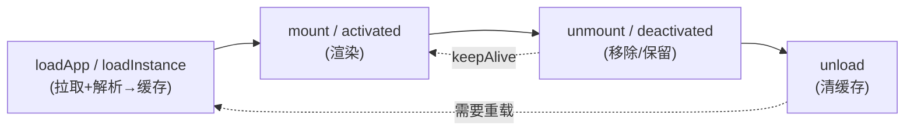

# 组合与自定义场景

BK-WeWeb 真正的灵活性在于：生命周期被拆成 `load` / `mount` / `unmount` / `activated` / `deactivated` / `unload` 等**正交的原子方法**，它们共享同一份全局缓存（以 `id` / `url` 为键）。你可以像搭积木一样**自由组合**这些原子方法，编排出预加载、KeepAlive、容器复用、命令式更新、热更新等各种微前端场景——而不必受标签用法的固定生命周期约束。

> 这正是 Hooks API 相比 `<bk-weweb>` 标签的核心优势：**标签是"约定好的固定流程"，Hooks 是"可编排的原子能力"**。需要任何非标准时序时，都用 Hooks 组合实现。

## 心智模型

记住三条规则，就能推导出几乎所有组合：

1. **加载与渲染分离**：`loadApp` / `loadInstance` 只拉取并解析资源写入缓存；`mount` / `activated` 才真正渲染。
2. **缓存以 key 为中心**：同一 `id` 多次操作命中同一实例；不同 `id` 是不同实例。
3. **失活由 `keepAlive` 决定**：`deactivated` 在 `keepAlive` 下保留状态，否则等价 `unmount`；`unload` 才真正清缓存。



---

## 场景 1：预加载 + 懒挂载

把耗时的网络与解析提前到空闲时间，用户真正进入时挂载几乎瞬时完成。

```ts
import { preLoadApp, mount, unmount } from '@blueking/bk-weweb';

// 首屏空闲时预加载（不渲染）
window.addEventListener('load', () => {
  setTimeout(() => {
    preLoadApp({ url: 'http://localhost:8001/', id: 'dashboard', scopeJs: true });
  }, 2000);
});

// 用户进入时：资源已就绪，挂载瞬时完成
function openDashboard(container: HTMLElement) {
  mount('dashboard', container);
}

function leaveDashboard() {
  unmount('dashboard');
}
```

> 标签用法也能受益：若元素连接时发现同 URL 应用已是预加载状态，会直接走 `activated` 激活。

---

## 场景 2：Tab / 路由 KeepAlive 复用

多个子应用像浏览器标签页一样切换，切走时保留滚动位置、表单、运行状态，切回秒级恢复。

```ts
import { loadApp, activated, deactivated } from '@blueking/bk-weweb';

const TABS = [
  { id: 'tab-list', url: 'http://localhost:8001/' },
  { id: 'tab-chart', url: 'http://localhost:8002/' },
];

// 初始化：加载时统一开启 keepAlive
async function setup() {
  for (const t of TABS) {
    await loadApp({ url: t.url, id: t.id, keepAlive: true });
  }
}

let current: string | null = null;

// 切换 Tab：失活旧的（保留），激活新的（恢复或首挂）
function switchTab(id: string, container: HTMLElement) {
  if (current && current !== id) deactivated(current);
  activated(id, container);
  current = id;
}
```

要点：`keepAlive: true` 时 `deactivated` 仅保留、`activated` 不重跑脚本；这是"复用"而非"重建"。

---

## 场景 3：单容器内多子应用切换

只有一个挂载区域，根据路由在其中切换不同子应用（不保留，每次重新挂载）。

```ts
import { loadApp, mount, unmount } from '@blueking/bk-weweb';

const container = document.getElementById('view')!;
let mounted: string | null = null;

async function navigate(id: string, url: string) {
  if (mounted) unmount(mounted);          // 卸载当前
  await loadApp({ url, id });             // 确保已加载（已缓存则瞬时返回）
  mount(id, container);                   // 挂载新的
  mounted = id;
}

navigate('page-a', 'http://localhost:8001/');
navigate('page-b', 'http://localhost:8002/'); // 自动卸载 a、挂载 b
```

> 想"切换保留"就把本场景换成场景 2 的 `keepAlive` + `activated`/`deactivated`。

---

## 场景 4：微模块命令式更新（不重新挂载）

微模块挂载后，拿到它的导出实例，后续只调用其方法更新数据，避免重复挂载与重渲染开销。

```ts
import { loadInstance, mount, unmount } from '@blueking/bk-weweb';

interface ChartApi {
  update(data: unknown): void;
  destroy(): void;
}

let api: ChartApi | undefined;

async function openChart(box: HTMLElement) {
  await loadInstance({ url: 'http://localhost:9001/chart.js', id: 'chart', data: { theme: 'dark' } });
  mount<ChartApi>('chart', box, (_inst, exportInstance) => {
    api = exportInstance;          // 拿到模块导出对象
  });
}

// 数据变化时：直接调模块方法，无需重新 mount
function refresh(data: unknown) {
  api?.update(data);
}

// 关闭：先让模块自清理，再卸载
function closeChart() {
  api?.destroy();
  unmount('chart');
}
```

模块侧需遵循 [render 导出规范](../micro-module/render-specification)，并自行暴露 `update` / `destroy` 等方法。

---

## 场景 5：同一模块的多个实例

同一份 JS bundle 在页面多处渲染、互不干扰——靠不同的 `id` 区分缓存实例。

```ts
import { loadInstance, mount } from '@blueking/bk-weweb';

const url = 'http://localhost:9001/widget.js';

await loadInstance({ url, id: 'widget-north', data: { region: 'north' } });
await loadInstance({ url, id: 'widget-south', data: { region: 'south' } });

mount('widget-north', document.getElementById('north')!);
mount('widget-south', document.getElementById('south')!);
```

::: warning 注意
若用相同 `id`，会命中同一缓存实例，无法得到两个独立实例。多实例务必用不同 `id`。
:::

---

## 场景 6：动态模式分发

不确定加载的是微应用还是微模块时，用统一入口 `load()`，它按 `mode` 自动分流到 `loadApp` / `loadInstance`。

```ts
import { load, mount, WewebMode } from '@blueking/bk-weweb';

async function openAny(config: { url: string; id: string; mode?: WewebMode }) {
  await load(config);            // mode==='js' → loadInstance；否则 loadApp
  mount(config.id, document.getElementById('view')!);
}

openAny({ url: 'http://localhost:8001/', id: 'app' });                       // 微应用
openAny({ url: 'http://localhost:9001/m.js', id: 'm', mode: WewebMode.INSTANCE }); // 微模块
```

适合"由后端配置驱动渲染哪种子应用"的低代码 / 编排型场景。

---

## 场景 7：强制热更新（丢弃缓存重载）

子应用发布了新版本，需要丢弃旧缓存、拉取最新资源。

```ts
import { unmount, unload, loadApp, mount } from '@blueking/bk-weweb';

async function hotReload(id: string, url: string, container: HTMLElement) {
  unmount(id);          // 1. 卸载当前视图
  unload(url);          // 2. 删除缓存实例（注意：传缓存键，微应用即 url）
  await loadApp({ url, id }); // 3. 重新加载最新资源
  mount(id, container); // 4. 重新挂载
}
```

> `unload` 接收的是缓存键。微应用 `appCacheKey` 为 `url`；若 `id` 与 `url` 不同，请确认传入正确的键。

---

## 场景 8：加载态 + 错误兜底 + 重试

`loadApp` 是异步的，可据此实现 loading / 失败 / 重试 UI。

```ts
import { loadApp, mount, unload } from '@blueking/bk-weweb';

async function openWithFallback(id: string, url: string, container: HTMLElement, retry = 1) {
  showSpinner(container);
  try {
    await loadApp({ url, id });
    mount(id, container, () => hideSpinner(container));
  } catch (e) {
    hideSpinner(container);
    if (retry > 0) {
      unload(url);                 // 清掉可能的半成品缓存
      return openWithFallback(id, url, container, retry - 1);
    }
    showError(container, e);
  }
}
```

::: tip
框架内置的资源请求兜底在失败时返回空字符串而非抛错。若想要更强的失败感知，可用[自定义资源获取](../advanced/fetch-source)包裹请求并在非 2xx 时主动抛错。
:::

---

## 场景 9：并行预加载 + 编排挂载顺序

一次性预取多个子应用，再按业务优先级编排挂载。

```ts
import { preLoadApp, mount } from '@blueking/bk-weweb';

// 并行预加载（各自在空闲时拉取）
['app-a', 'app-b', 'app-c'].forEach((id, i) =>
  preLoadApp({ url: `http://localhost:800${i + 1}/`, id }),
);

// 按顺序挂载（资源大概率已就绪）
async function layout(containers: Record<string, HTMLElement>) {
  mount('app-a', containers.a); // 先挂主区
  requestIdleCallback(() => mount('app-b', containers.b)); // 次要区延后
  requestIdleCallback(() => mount('app-c', containers.c));
}
```

---

## 选择指南

| 你的诉求 | 推荐组合 |
| --- | --- |
| 切换更快 | [预加载](../advanced/preload) + 懒 `mount`（场景 1） |
| 切走要保留状态 | `keepAlive` + `activated` / `deactivated`（场景 2） |
| 切走即销毁 | `mount` / `unmount`（场景 3） |
| 频繁更新数据 | 微模块导出方法 + 命令式 `update`（场景 4） |
| 多处复用同一模块 | 不同 `id` 多实例（场景 5） |
| 配置驱动渲染 | `load()` 动态分发（场景 6） |
| 子应用升级 | `unmount` + `unload` + `loadApp`（场景 7） |

各原子方法的完整签名见 [Hooks 概览](./)。
