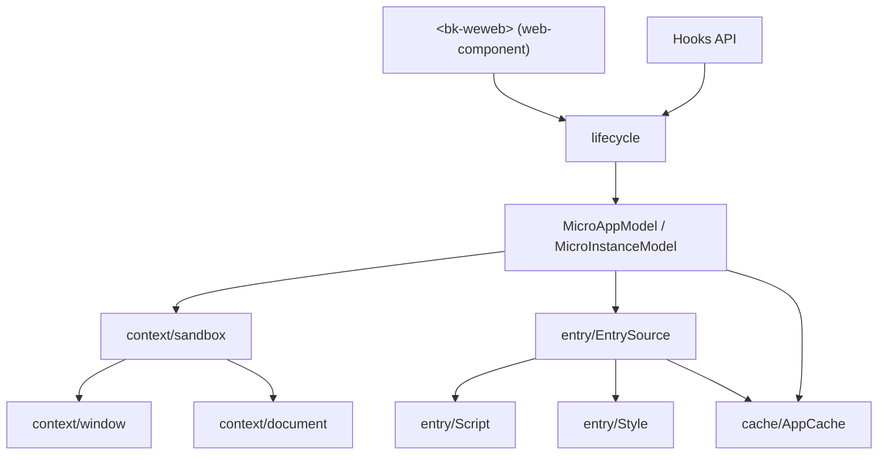
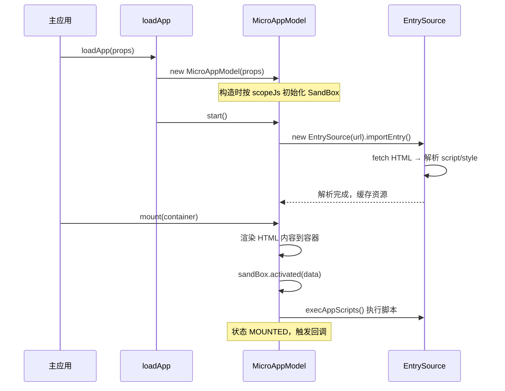

# 整体架构

本章从源码模块分层与核心流程两个角度，介绍 BK-WeWeb 的内部实现。

## 模块分层

源码位于 `src/`，按职责划分为如下模块：

| 模块 | 目录 | 职责 |
| --- | --- | --- |
| 入口 | `index.ts` | 定义 `WeWeb` 类与 `start`，注册自定义元素，re-export 各 API |
| 容器组件 | `component/web-component.ts` | `BkWewebElement`，解析标签属性、驱动生命周期 |
| 模型 | `mode/app.ts`、`mode/instance.ts` | `MicroAppModel` / `MicroInstanceModel`，承载状态与挂载逻辑 |
| 生命周期 | `lifecycle/*` | `load` / `mount` / `unmount` / `activated` / `deactivated` / `unload` 等 Hooks |
| 预加载 | `preload/preload.ts` | `preLoadApp` / `preLoadInstance` / `preLoadSource` |
| 沙箱 | `context/*` | `sandbox` / `window` / `document` / `function` / `event`，JS 隔离 |
| 资源解析 | `entry/*` | `EntrySource` / `Script` / `Style`，解析入口、改写脚本与样式 |
| 缓存 | `cache/app-cache.ts` | `AppCache`，应用实例与共享资源缓存 |
| 主应用资源 | `base-app/*` | `collectBaseSource`，收集并共享主应用资源 |
| 工具 | `utils/*` | `fetch` / `load-source` / `common` 等 |
| Vite 插件 | `vite/helper.ts` | 开发模式下注入沙箱全局变量 |

模块间的依赖关系大致如下：



## 应用缓存

所有应用/模块实例都存放在一个全局 `AppCache` 单例中（`Map<string, BaseModel>`），以 `appCacheKey`（微应用为 `url`，微模块为 `id`）为键。它还持有一个 `baseSource`（主应用共享资源）。

框架在真实 `window` 上注册了 `__getAppOrInstance__(id?)`：不传 `id` 返回 `AppCache`，传 `id` 返回对应实例，便于跨应用查找与调试。

## 加载到挂载的主流程

以微应用为例（Hooks 用法）：



关键点：

- **`load` 与 `mount` 分离**：`start()` 只拉取并解析资源；`mount()` 才渲染并执行脚本。这使[预加载](../advanced/preload)成为可能。
- **沙箱在构造时创建**（若 `scopeJs`），在 `mount` / `activated` 时 `activated`，在 `unmount` / `deactivated` 时 `deactivated`。
- **微模块流程**类似，但入口是 JS，挂载时创建包裹容器、执行脚本后调用导出对象的 `render`。

## 状态机

实例状态由 `AppState` 描述，生命周期方法驱动流转：

```
UNSET → LOADING → LOADED → MOUNTING → MOUNTED
                                   ↘ DEACTIVATED ⇄ ACTIVATED
                                   ↘ UNMOUNT
                （任意阶段出错 → ERROR）
```

`appCache.hasActiveApp` 通过"是否存在非 `UNMOUNT` 状态的实例"判断当前是否还有活跃应用；当全部卸载后，框架会还原被改写的全局 DOM 方法。

## 深入

- JS 隔离细节见 [沙箱实现](./sandbox)。
- 资源解析细节见 [资源解析](./entry)。
